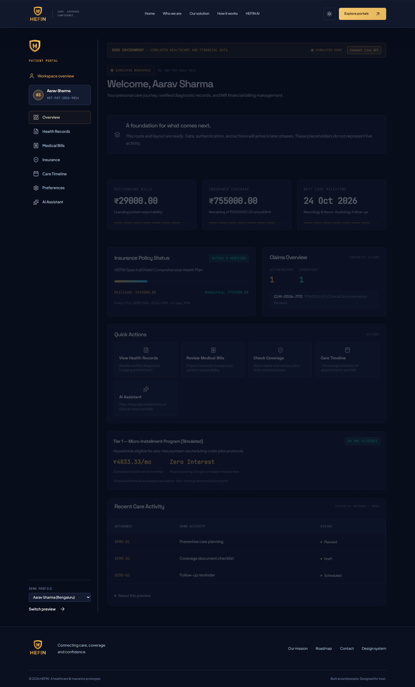
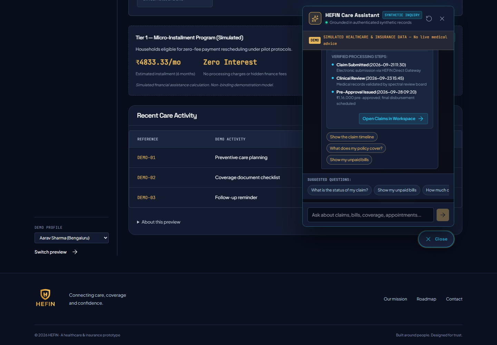
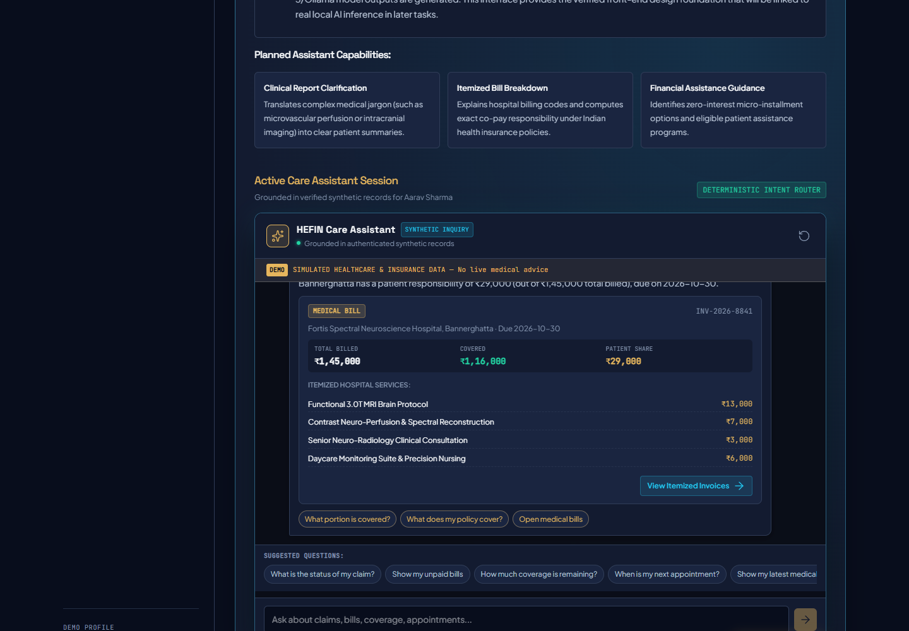
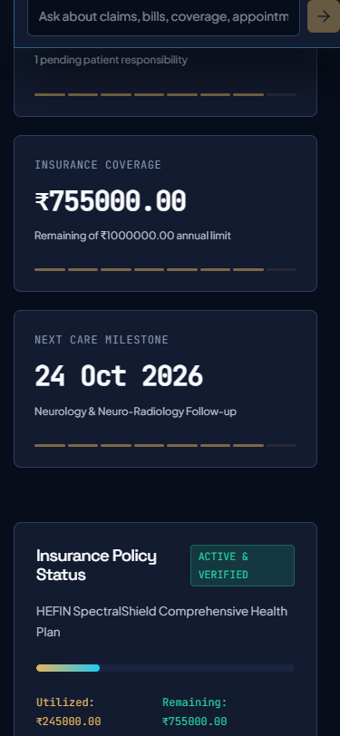
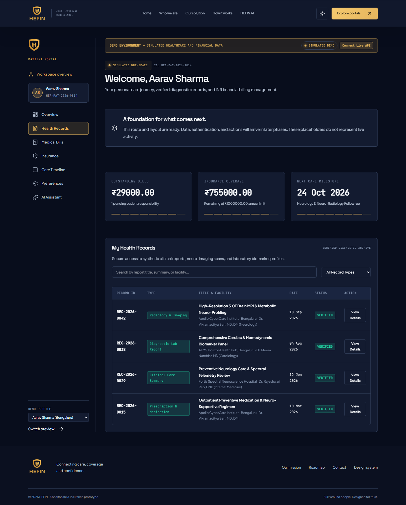
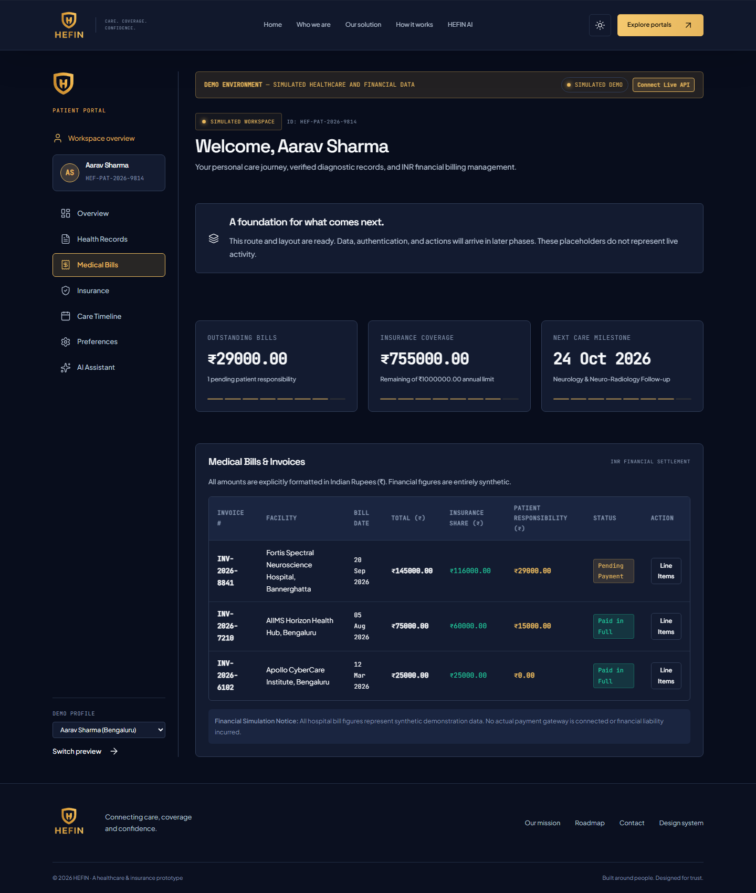
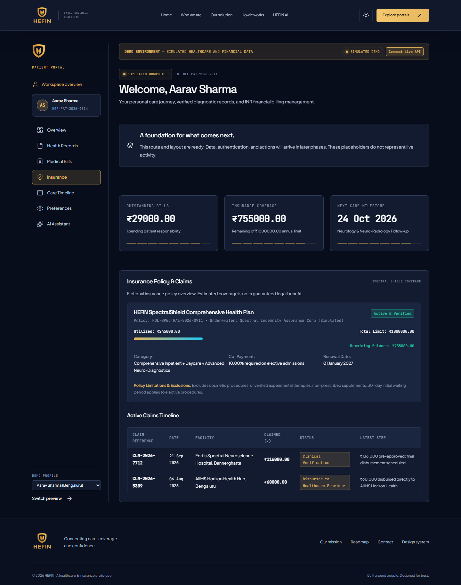
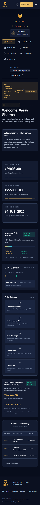

# HEFIN 3.0 — Task 04: Functional Patient Portal, Grounded Care Assistant & Django API Foundation

## Executive Summary

Task 04 establishes the first functional application milestone for HEFIN 3.0. It delivers:
1. **A responsive, professional Patient Workspace** built in Angular, replacing the static preview with 7 dedicated tabs (Dashboard Overview, Health Records, Medical Bills in INR, Insurance Policy & Claims, Care Timeline, Profile & Accessibility Preferences, and an integrated Care Assistant).
2. **A grounded, deterministic Care Assistant** (`backend/apps/assistant/` & `frontend/src/app/shared/components/assistant/`), providing both an inline dashboard workspace and a persistent floating launcher. All inquiries (claim tracking, itemized bills in INR, insurance coverage, upcoming appointments, and care timelines) are grounded directly in the patient's authenticated records with strict data isolation, zero hallucinated medical advice, and zero fabricated LLM claims.
3. **A robust Django REST Framework backend** (`backend/`) structured into modular domain applications (`accounts`, `patients`, `records`, `billing`, `insurance`, `appointments`, `assistant`), using token authentication and strict patient-scoped data isolation.
4. **A database foundation** designed with Django ORM, supporting zero-setup SQLite for local testing and PostgreSQL for production environments via `DATABASE_URL` or standard database environment parameters.
5. **Idempotent synthetic demo data seeding** (`python manage.py seed_demo`) creating 3 realistic patient identities with records, itemized bills with INR decimal accuracy, and insurance policies.
6. **Full compatibility with existing Task 03 assets**, retaining the cinematic 3D brain and hospital scenes, gold branding, typography tokens, and GitHub Pages static hosting limitations without broken network calls.

---

## Architecture Overview

```
HEFIN 3.0 SYSTEM TOPOLOGY
┌────────────────────────────────────────────────────────────────────────┐
│ Angular 22 Frontend (Client Layer)                                     │
│ ├─ Route: /patient/dashboard                                           │
│ ├─ State & API Service: PatientApiService & ChatService                │
│ ├─ Chatbot Interface: AssistantChatComponent (Floating + Inline Modes) │
│ ├─ Mode Switcher: Simulated Mode (Static/Pages) vs Live API (Django)   │
│ └─ Design Tokens: Midnight Navy, HEFIN Gold, Cyan, Violet, Glass       │
└───────────────────────────────────┬────────────────────────────────────┘
                                    │ HTTP / REST (/api/v1/)
                                    │ Authorization: Token <key>
┌───────────────────────────────────▼────────────────────────────────────┐
│ Django REST Framework Backend (Application Layer)                     │
│ ├─ apps/accounts/     -> Custom User (AbstractUser), Token Auth        │
│ ├─ apps/patients/     -> PatientProfile, Dashboard & Profile Views     │
│ ├─ apps/records/      -> MedicalRecord, Vitals, Search & Type Filter   │
│ ├─ apps/billing/      -> MedicalBill, BillLineItem (INR Decimal)       │
│ ├─ apps/insurance/    -> InsurancePolicy, InsuranceClaim, Timeline     │
│ ├─ apps/appointments/ -> Appointment, CareEvent Timeline Aggregator    │
│ └─ apps/assistant/    -> ChatMessage, AssistantIntentRouter            │
└───────────────────────────────────┬────────────────────────────────────┘
                                    │ Django ORM (Migrations)
┌───────────────────────────────────▼────────────────────────────────────┐
│ Database Layer                                                         │
│ ├─ Default Development: SQLite (db.sqlite3)                            │
│ └─ Production Target: PostgreSQL 15+ (psycopg / DATABASE_URL)         │
└────────────────────────────────────────────────────────────────────────┘
```

---

## Frontend Routes & Patient Portal Experience

The Patient Portal lives at route `/patient/dashboard` and provides 7 functional workspace sections:

### A. Patient Dashboard (Overview)
- **Patient greeting & simulated identifier:** e.g., `Welcome, Aarav Sharma` with identifier `HEF-PAT-2026-9814`.
- **Top Disclaimer Banner:** `DEMO ENVIRONMENT — SIMULATED HEALTHCARE AND FINANCIAL DATA`.
- **Summary Metric Cards:** 
  - Outstanding Medical Bills: formatted in INR (`₹29,000.00`, 1 pending bill).
  - Insurance Coverage: utilized vs remaining (`₹7,55,000.00` remaining of `₹10,00,000.00` limit).
  - Next Care Milestone: upcoming appointment tracking.
- **Recent Care Activity Table:** lists facility, clinician, service type, and date.
- **Active Claims Overview & Quick Actions:** navigate to records, bills, policies, and appointments.
- **Financial Assistance Overview:** zero-interest micro-installment notice.

### B. My Health Records
- Record listings with record type, title, facility, clinician, and record date.
- Real-time search by title, summary, clinician, or facility.
- Filter dropdown by clinical category (`Consultation Note`, `Diagnostic Lab Report`, `Radiology & Imaging`, `Prescription & Medication`, `Discharge Summary`).
- Slide-over detail drawer displaying full clinical summary, clinician notes, and structured vitals (Blood Pressure, Pulse, SpO2, BMI, Temperature).

### C. Medical Bills
- Invoice listing with invoice number, facility, bill date, total amount, simulated insurance coverage amount, estimated patient responsibility, and payment status badge (`Pending Payment`, `Paid in Full`).
- **INR Currency handling:** All figures formatted with `₹` and simulated disclaimers.
- Detail drawer with itemized hospital line items breakdown (Service description, Code, Quantity, Total Price in INR, and Patient Share in INR).

### D. Insurance Coverage
- Fictional insurance policy overview (Policy number, Underwriter, Status).
- Visual progress track showing utilized coverage (`₹2,45,000.00` / `24.5%`) vs remaining balance (`₹7,55,000.00`).
- Co-payment percentage (10.0%) and renewal date.
- Policy limitations and exclusions disclosure.
- Active claims timeline table with claim reference, facility, claimed amount, status, and latest step notes.

### E. Care Timeline
- Chronological, unified event feed merging appointment bookings, hospital visits, diagnostic test results, issued bills, and submitted claims.

### F. Profile & Accessibility Preferences
- Patient demographics, blood group, address, known allergies, and chronic conditions.
- Interactive accessibility toggles:
  - *Prefer Reduced Motion:* Disables 3D model orbit loops and transitions.
  - *High Contrast Mode:* Enhances borders and text legibility.
  - *Email & SMS Alerts:* Configurable notification preferences.

### G. HEFIN Care Assistant (Grounded Clinical & Financial Explainer)
- **Deterministic Intent Classification:** Maps conversational queries strictly to authenticated patient records:
  1. *Claim Status & Tracking:* Retrieves claim references (`CLM-2026-7702`), hospital names, claimed vs approved amounts in INR, current workflow stages, missing document notices, and chronological processing steps.
  2. *Hospital Billing & Invoices:* Explains invoices, total billed amounts, insurance portions, patient co-pay responsibilities, and itemized hospital service line items.
  3. *Insurance Policy Coverage:* Computes active policy details, annual coverage limits, utilized vs remaining balances, co-pay percentages, and exclusions.
  4. *Appointments & Consultations:* Retrieves upcoming clinician consultations, facilities, and instructions.
  5. *Health Records & Vitals:* Summarizes verified laboratory and imaging reports with structured vital signs.
  6. *Care Journey Timeline:* Aggregates recent healthcare events with chronological traces.
  7. *Clinical Advice Guardrail:* Actively detects medical diagnosis or drug dosage inquiries, refuses medical advice, and directs patients to licensed physicians.
  8. *Read-Only Guardrails:* Rejects requests to delete or fabricate clinical records.
- **Dual Display Modes:**
  - *Persistent Floating Launcher:* Circular gold button (`#assistant-launcher-btn`) with subtle pulse animation, accessible from every tab.
  - *Inline Workspace Session:* Embedded directly within the AI Assistant section of the portal.
- **Structured Response Cards:** Rich visual cards (`claim`, `bill`, `insurance`, `appointment`, `record`, `timeline`, `navigation`) with direct action buttons that navigate the user to the corresponding workspace tab.
- **Active Session Management:** Chat history is maintained in the active session and can be cleared at any time via the reset control.

---

## Design System & Aesthetics

In compliance with Task 03 and Task 04 design requirements:
- **Color Palette:** Midnight navy (`#050814`, `#0b1026`), HEFIN gold (`#c5a059`), cyan highlights (`#38bdf8`), violet accents (`#818cf8`), emerald for verified items (`#10b981`), rose for pending alerts (`#f43f5e`).
- **Typography:** Space Grotesk for section headings, Plus Jakarta Sans for body copy, JetBrains Mono for monetary metrics and identifiers, Orbitron for futuristic badges.
- **Glassmorphism:** Layered surfaces with subtle translucent backdrops (`color-mix` with srgb).
- **Responsiveness:** Desktop sidebar navigation switches to accessible horizontal tab bar on screens `< 900px`. Mobile assistant expands to a full-screen, touch-friendly overlay.
- **No WebGL Overhead:** Preserves 60fps responsiveness across all views.

---

## Visual Verification & Screenshots

| View | Screenshot File | Description |
| :--- | :--- | :--- |
| **Desktop Dashboard** |  | Overview tab with greeting, metrics, and care activity |
| **Floating Care Assistant** |  | Floating chat panel displaying grounded claim progress card |
| **Inline Assistant Session** |  | Embedded Care Assistant in AI Assistant tab with INR bill breakdown |
| **Mobile Care Assistant** |  | Full-screen responsive assistant panel at 375px mobile viewport |
| **Health Records** |  | Searchable records table with category filters |
| **Medical Bills** |  | Itemized bills with INR currency formatting |
| **Insurance Coverage** |  | Policy card, utilization progress bar, exclusions |
| **Mobile Portal** |  | Responsive layout at 375px viewport (iPhone 13) |

---

## Backend Architecture & Database Models

The Django backend (`backend/`) is structured into decoupled domain apps:

### 1. `apps/accounts/`
- **`User` (AbstractUser):** Custom user model with `role` (`PATIENT`, `HOSPITAL_STAFF`, `INSURER`, `GOVERNMENT_AUDITOR`).
- **Token Authentication:** Standard DRF authtoken mechanism.

### 2. `apps/patients/`
- **`PatientProfile`:** Links one-to-one with `User`.
  - Fields: `patient_identifier` (unique, e.g. `HEF-PAT-2026-9814`), `date_of_birth`, `gender`, `blood_group`, `phone_number`, `address_city`, `address_state`, `allergies`, `chronic_conditions`, `reduced_motion`, `high_contrast`, `font_scale`, `email_notifications`, `sms_alerts`.

### 3. `apps/records/`
- **`MedicalRecord`:** Scoped to `PatientProfile`.
  - Fields: `record_identifier`, `record_type`, `title`, `healthcare_facility`, `attending_clinician`, `record_date`, `summary`, `clinical_notes`, `vitals` (JSONField storing BP, pulse, SpO2, BMI).

### 4. `apps/billing/`
- **`MedicalBill`:** Scoped to `PatientProfile`.
  - Fields: `invoice_number`, `hospital_name`, `bill_date`, `due_date`, `total_amount` (Decimal), `simulated_coverage_amount` (Decimal), `estimated_patient_responsibility` (Decimal), `currency` (`INR`), `payment_status` (`PENDING`, `PAID`, `DISPUTED`).
- **`BillLineItem`:** Foreign key to `MedicalBill`.
  - Fields: `service_code`, `description`, `quantity`, `unit_price`, `total_price`, `patient_share`.

### 5. `apps/insurance/`
- **`InsurancePolicy`:** Scoped to `PatientProfile`.
  - Fields: `policy_number`, `plan_name`, `fictional_insurer`, `coverage_category`, `coverage_limit`, `used_coverage`, `co_pay_percentage`, `status`, `renewal_date`, `exclusions_summary`.
- **`InsuranceClaim`:** Foreign key to `InsurancePolicy` and `PatientProfile`.
  - Fields: `claim_reference`, `hospital_name`, `claimed_amount`, `approved_amount`, `settlement_status`, `timeline_steps` (JSONField with chronological notes).

### 6. `apps/appointments/`
- **`Appointment`:** Scoped to `PatientProfile`.
  - Fields: `facility_name`, `clinician_name`, `department`, `appointment_date`, `status`, `reason`.
- **`CareEvent`:** Chronological care feed aggregator.
  - Fields: `event_type`, `event_date`, `title`, `facility`, `summary`, `related_reference`.

### 7. `apps/assistant/`
- **`ChatMessage`:** Scoped to `PatientProfile`.
  - Fields: `patient` (ForeignKey), `role` (`user` / `assistant`), `content` (TextField), `intent` (CharField), `cards` (JSONField), `suggested_actions` (JSONField), `navigation_target` (CharField), `is_simulated` (BooleanField), `created_at` (DateTimeField).
- **`AssistantIntentRouter`:** Service executing deterministic intent matching against the patient's authenticated records, producing structured card payloads and INR currency formatting.

---

## REST API Reference (`/api/v1/`)

All private endpoints require `Authorization: Token <token>` header and enforce patient-scoped querysets.

| Method | Endpoint | Description | Query Parameters |
| :--- | :--- | :--- | :--- |
| `GET` | `/api/v1/status/` | Health check & API version | None |
| `POST` | `/api/v1/accounts/login/` | User authentication | `{ username, password }` |
| `POST` | `/api/v1/accounts/logout/` | Token revocation | None |
| `GET` | `/api/v1/patient/dashboard/` | Aggregated dashboard summary | None |
| `GET` | `/api/v1/patient/profile/` | Patient demographic profile | None |
| `PATCH`| `/api/v1/patient/profile/` | Update non-sensitive preferences | `{ reduced_motion, ... }` |
| `GET` | `/api/v1/records/` | Patient medical records list | `?record_type=`, `?search=` |
| `GET` | `/api/v1/records/{id}/` | Single record detail | None |
| `GET` | `/api/v1/billing/` | Patient invoices list | `?payment_status=`, `?search=` |
| `GET` | `/api/v1/billing/{id}/` | Invoice detail with line items | None |
| `GET` | `/api/v1/insurance/policies/` | Insurance policies list | None |
| `GET` | `/api/v1/insurance/claims/` | Insurance claims list | `?status=` |
| `GET` | `/api/v1/appointments/` | Appointments list | `?time=upcoming\|past` |
| `GET` | `/api/v1/timeline/` | Chronological care feed | `?type=` |
| `GET` | `/api/v1/assistant/messages/` | Retrieve chat message history | None |
| `POST` | `/api/v1/assistant/messages/` | Send message and receive grounded response | `{ "message": "..." }` |
| `DELETE`| `/api/v1/assistant/messages/` | Clear active session chat history | None |
| `POST` | `/api/v1/assistant/clear/` | Explicit clear session endpoint | None |

---

## Authentication & Patient Data Isolation

1. **Password Hashing:** Uses Django's default PBKDF2 with SHA-256 password hasher. No plaintext credentials are ever stored.
2. **Object-Level Authorization & Queryset Scoping:** Every view overrides `get_queryset()` to filter strictly by `request.user.patient_profile`. An authenticated patient cannot view, query, or mutate another patient's records, invoices, claims, or assistant chat messages.
3. **Cross-Patient Query Isolation:** The Care Assistant explicitly validates that query results only reflect the authenticated user's records. For example, when Priya Patel queries her claim, the assistant returns `CLM-2026-7712` and cannot disclose Aarav Sharma's `CLM-2026-7702`.
4. **No Auth in URL Parameters:** Tokens are transferred strictly via HTTP `Authorization: Token <key>` headers.
5. **CORS & CSRF:** Strict CORS headers permitting only configured local frontend hosts.

---

## Synthetic Demo Data

The seed command is repeatable, safe, and ASCII-clean:
```powershell
python backend/manage.py seed_demo
```

### Seeded Demo Accounts:
| Username | Password | Patient Name | Identifier | Primary Policy |
| :--- | :--- | :--- | :--- | :--- |
| `aarav.sharma` | `demo1234` | Aarav Sharma | `HEF-PAT-2026-9814` | `POL-SPECTRAL-2026-0911` |
| `priya.patel` | `demo1234` | Priya Patel | `HEF-PAT-2026-4402` | `POL-SPECTRAL-2026-3391` |
| `rohan.verma` | `demo1234` | Rohan Verma | `HEF-PAT-2026-1189` | `POL-SPECTRAL-2026-5820` |

---

## GitHub Pages & Static Preview Mode

GitHub Pages hosts only the static Angular bundle. It cannot execute Django or PostgreSQL. To handle this limitation honestly and gracefully:
1. **Configurable API URL:** `environment.apiBaseUrl` can be set via `window.__HEFIN_CONFIG__?.apiBaseUrl` or localStorage.
2. **Default Simulated Mode:** In static environments (GitHub Pages, tests, initial clone), the frontend defaults to **Simulated Mode**, rendering rich synthetic data locally without firing unprompted network calls that would trigger console errors.
3. **Simulated Care Assistant:** Generates instant, grounded responses from local synthetic data with zero network latency and identical card payloads.
4. **Honest Unavailable State:** In Live API mode, if the backend dev server is down, the frontend does **not** silently pretend it succeeded; it renders an explicit, honest `Backend service is temporarily unreachable` alert banner with retry and mode-switch options.

---

## Verification Test Results

### 1. Backend Test Suite (Django)
```powershell
python backend/manage.py test tests
```
- **Result:** `Ran 34 tests in 83.6s — OK`
- Model validation (Decimal constraints, positive amount validation)
- Token authentication & credential validation
- Strict patient isolation (Cross-patient access rejection)
- Care Assistant intent routing, grounded responses, session tracking, and clear chat
- API endpoint status, serializers, and filtering

### 2. Frontend Test Suite (Playwright)
```powershell
npm test
```
- **Total Tests:** 82 executed across Desktop (1440x1000) and Mobile (iPhone 13 / 375x812)
- **Passed:** 79 passed
- **Skipped:** 3 (intentional mobile viewport exclusions in cinematic tests)
- **Failed:** 0
- **Suites Covered:**
  - `tests/care-assistant.spec.ts` (26 tests: floating launcher, open/close, inline assistant, claim progress card, itemized bills in INR, insurance coverage, appointments, quick action chips, card navigation, clear chat, empty/unsupported input, API failure warning, mobile responsiveness, Escape key accessibility)
  - `tests/patient-portal.spec.ts` (14 tests: 7 workspace tabs, INR billing, line items, search, drawer modals, accessibility preferences, honest offline error banner)
  - `tests/cinematic.spec.ts` (3D brain/hospital scene, material toggles, orbit reset)
  - `tests/foundation.spec.ts` (all routes zero console errors, zero horizontal overflow)
  - `tests/landing-3d.spec.ts` (Three.js life cycle, canvas cleanup, breakpoint readability)

### 3. PostgreSQL Database Check
- **Result:** PostgreSQL service was not detected in the local development environment (`psql` command not found). Django ORM executed against the zero-setup SQLite engine (`db.sqlite3`), with full ORM migration parity for PostgreSQL deployment.

---

---

## Render Deployment Architecture (Task 04 Add-On)

HEFIN 3.0 provides an Infrastructure-as-Code Blueprint (`render.yaml`) enabling deployment of the Django REST backend and PostgreSQL database on Render, while maintaining the Angular frontend on GitHub Pages.

### 1. Topology & Service Blueprint (`render.yaml`)

```yaml
services:
  - type: web
    name: hefin-backend
    runtime: python
    region: oregon
    plan: free
    branch: hefin-3.0-development
    buildCommand: "pip install -r backend/requirements.txt && python backend/manage.py collectstatic --no-input"
    startCommand: "python backend/manage.py migrate --no-input && gunicorn --chdir backend config.wsgi:application --bind 0.0.0.0:$PORT --workers 2 --threads 4 --timeout 120"
    healthCheckPath: /healthz/
    envVars:
      - key: PYTHON_VERSION
        value: 3.11.9
      - key: DJANGO_DEBUG
        value: "False"
      - key: DJANGO_SECRET_KEY
        generateValue: true
      - key: DATABASE_URL
        fromDatabase:
          name: hefin-postgres
          property: connectionString
      - key: DJANGO_ALLOWED_HOSTS
        value: "localhost,127.0.0.1,.onrender.com"
      - key: CORS_ALLOWED_ORIGINS
        value: "https://hariharasuthan1105.github.io"
      - key: CSRF_TRUSTED_ORIGINS
        value: "https://hariharasuthan1105.github.io,https://*.onrender.com"

databases:
  - name: hefin-postgres
    databaseName: hefindb
    user: hefin
    plan: free
    region: oregon
```

### 2. PostgreSQL Configuration & Secret Management
- **Database Engine:** Managed PostgreSQL on Render (Internal connection string provided automatically via `fromDatabase: connectionString`).
- **Production PostgreSQL Enforcement:** [`backend/config/settings.py`](file:///c:/Users/hariharasuthan/Downloads/-HEFIN-main%20%282%29/-HEFIN-main/backend/config/settings.py) dynamically uses `dj_database_url.config()` when `DATABASE_URL` is set, with `conn_max_age=600`. In production (`DEBUG=False`), SQLite is strictly blocked with an `ImproperlyConfigured` exception; PostgreSQL is required.
- **Local Fallback:** Falls back cleanly to SQLite (`db.sqlite3`) for local zero-dependency testing only when `DEBUG=True`.
- **Secret Key Enforcement:** `DJANGO_SECRET_KEY` is generated and managed through Render environment variables. In production, Django refuses to start if `DJANGO_SECRET_KEY` is missing.

### 3. Production Hardening, HTTPS & Strict CORS
- **Debug:** Forced to `DEBUG = False` via `DJANGO_DEBUG="False"`.
- **Gunicorn:** Multi-worker WSGI server (`gunicorn --chdir backend config.wsgi:application --workers 2 --threads 4`).
- **WhiteNoise:** Serves static files directly from Gunicorn via `CompressedManifestStaticFilesStorage`.
- **SSL / Proxy:** Configured with `SECURE_PROXY_SSL_HEADER = ('HTTP_X_FORWARDED_PROTO', 'https')`, `SESSION_COOKIE_SECURE = True`, and `CSRF_COOKIE_SECURE = True`.
- **Strict CORS / CSRF:** In production (`DEBUG=False`), CORS strictly permits only the intended GitHub Pages frontend (`https://hariharasuthan1105.github.io`). Arbitrary or insecure origins are blocked.
- **Explicit Demo Seeding:** `seed_demo` is removed from the automatic production startup sequence. In production (`DEBUG=False`), `seed_demo` requires explicit authorization via `--force` or `ALLOW_DEMO_SEEDING=True`.

### 4. Health-Check Endpoints
- `GET /healthz/` and `GET /`: Fast 200 OK JSON status responding with version, health status, and demo disclaimer.
- `GET /api/v1/status/`: Full API catalog with all endpoint routes.

### 5. Frontend API Dynamic Routing & Safe Origin Sanitization
[`frontend/src/environments/environment.ts`](file:///c:/Users/hariharasuthan/Downloads/-HEFIN-main%20%282%29/-HEFIN-main/frontend/src/environments/environment.ts) detects the hosting environment:
- When hosted on `https://hariharasuthan1105.github.io/`, it targets `https://hefin-backend.onrender.com/api/v1`.
- When running locally (`localhost` / `127.0.0.1`), it targets `http://127.0.0.1:8000/api/v1`.
- **Safe Origin Sanitization:** Custom API URL overrides (via `window.__HEFIN_CONFIG__.apiBaseUrl` or `localStorage`) are sanitized through `sanitizeApiUrl(...)`. Dangerous schemes (e.g. `javascript:`, `data:`), credentials in URLs, and unencrypted remote HTTP endpoints are rejected, falling back safely to the official Render endpoint.
- If the backend is unreachable or sleeping, the frontend displays an explicit, honest status banner rather than silently simulating responses.

### 6. Step-by-Step Render Deployment Guide

When ready to provision the backend on Render:
1. Log in to [Render Dashboard](https://dashboard.render.com/).
2. Click **New +** -> **Blueprint**.
3. Connect the repository `https://github.com/hariharasuthan1105/-HEFIN`.
4. Select the `hefin-3.0-development` branch.
5. Render will automatically detect `render.yaml` and display the resources (`hefin-backend` web service and `hefin-postgres` database).
6. Review the plan (Free tier, $0.00/mo) and click **Apply**.
7. Render provisions the database, runs `pip install`, collects static files, executes database migrations, and launches Gunicorn.
8. If demo data seeding is desired in an isolated demo deployment, run `python backend/manage.py seed_demo --force` via the Render Shell or SSH console.
9. Verify deployment by visiting `https://<service-name>.onrender.com/healthz/`.

---

## Security & Deployment Limitations

- **Not Certified for Production Healthcare:** This prototype uses synthetic demonstration data. It is not certified under HIPAA, GDPR, or DISHA (Digital Information Security in Healthcare Act).
- **Deterministic Rule Router:** The Care Assistant currently operates via deterministic, rule-based intent routing over authenticated patient records. It does not execute raw generative LLMs or make outside calls to Gemma 3 / Ollama.
- **Demo Passwords:** Simple passwords (`demo1234`) are provided for local evaluation only.
- **Tokens in LocalStorage:** For demonstration convenience, auth tokens are retained in browser session storage; a production deployment would implement secure `HttpOnly`, `SameSite=Strict` cookies with short-lived tokens and refresh rotation.
- **Render Free Tier Spin-Down:** On Render Free tier, web services spin down after 15 minutes of inactivity and take ~50 seconds to cold start on the next request. Free databases expire after 30 days unless upgraded.

---

## Remaining Work (Future Tasks)

1. **Task 05+:** Implementation of Hospital Staff, Insurance Adjuster, and Government Auditor workspaces.
2. **Local AI Model Execution:** Integration of local LLM models (e.g., Ollama / Gemma 3) to power deep clinical free-text report explainability.
3. **Advanced Security:** OAuth2 / OpenID Connect, audit logging, and signed FHIR / ABHA compliance records.

